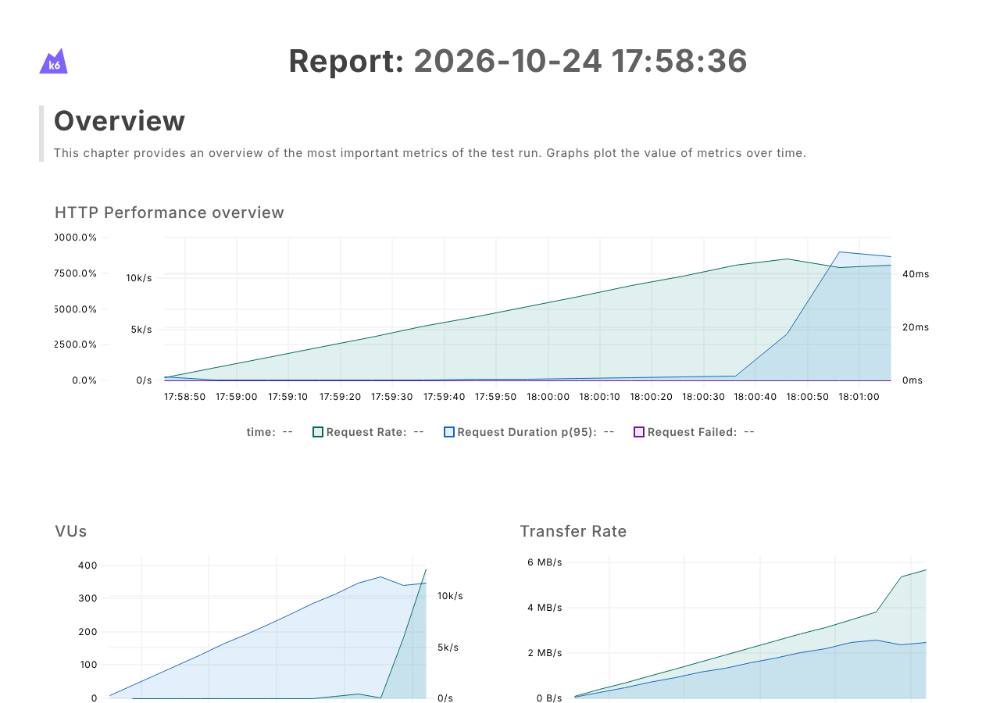

# Performance testing with k6

[](https://github.com/VincentJerico/performance-testing/actions/workflows/ci.yml)


Performance tests for [TaskFlow](https://github.com/VincentJerico/taskflow-under-test), the task
manager I built to be tested. I own the app, so I can do what you shouldn't do to someone else's
demo site: push it until it breaks, enforce the results in CI, and dig into why it broke.

Every push runs a smoke test and a load test against TaskFlow in GitHub Actions, and **the build
fails if any endpoint misses its latency budget**. Every night, stress, spike, soak, breakpoint
and two root-cause experiments run as well.

It's part of my [QA Engineering Journey](https://github.com/VincentJerico/qa-engineering-journey).

## What I found

| ID                                                                                        | Finding                                                                                                                                 | Severity |
| ----------------------------------------------------------------------------------------- | --------------------------------------------------------------------------------------------------------------------------------------- | -------- |
| [PERF-001](docs/FINDINGS.md#perf-001-login-traffic-stalls-every-other-request)            | 60 logins per second pushed an unrelated 2 ms read to **12 seconds** at p95. Password hashing (`scryptSync`) blocks Node's only thread. | High     |
| [PERF-002](docs/FINDINGS.md#perf-002-the-task-list-has-no-pagination)                     | `GET /api/tasks` has no pagination: 1.24 MB per board load at 10,000 tasks.                                                             | Low      |
| [OBS-001](docs/FINDINGS.md#obs-001-task-crud-is-fast-capacity-depends-on-the-traffic-mix) | Task CRUD held over 7,000 requests/s with no errors. Capacity depends on the traffic mix, not one number.                               | Info     |

The full write-ups, with evidence, root cause and a fix to re-test, are in
[docs/FINDINGS.md](docs/FINDINGS.md). Raw numbers are in [docs/results/](docs/results/).



## How it works

```
performance-testing/
├── lib/
│   ├── config.js        # BASE_URL, think time, per-run user names
│   ├── taskflow.js      # API client: every request is tagged by endpoint, with checks on the body
│   ├── journey.js       # setup() user pool + the task journey all scenarios share
│   ├── slo.js           # latency budgets per endpoint, used as k6 thresholds
│   └── report.js        # Markdown tables for the experiments
├── scenarios/           # smoke, load, stress, spike, soak, breakpoint
├── experiments/
│   ├── auth-contention.js   # does login traffic slow everyone else? (PERF-001)
│   └── list-growth.js       # how does the list endpoint scale with data? (PERF-002)
├── selftest/
│   └── gate-must-fail.sh    # proves the SLO gate can fail
├── scripts/
│   ├── check-auth-contention.mjs  # PERF-001 gate: logins must not slow other reads
│   ├── check-soak-rss.mjs         # OBS-002 gate: memory must flatten during the soak
│   └── ...              # start/stop TaskFlow, run with reports, CI job summary, memory sampling
├── test/                # self-tests for the gate checkers, on real CI output
└── docs/                # test plan, findings, results
```

**One journey, many shapes.** Every scenario runs the same user journey: open the board, add a
task, open it, mark it done, check the board, delete it (6 requests, 1 s think time). The
scenarios only change how many users run it and when. Users sign in once in `setup()`, as real
users keep a session, so login load is measured on its own where it matters.

**SLOs are the gate.** Each endpoint has a p95 budget in [lib/slo.js](lib/slo.js). k6 exits with
code 99 when a threshold is crossed, which fails the CI job.

**A gate that can't fail isn't a gate.** If a threshold's tag or metric name is wrong, k6 quietly
evaluates nothing and passes. [selftest/gate-must-fail.sh](selftest/gate-must-fail.sh) runs the
smoke test with impossible budgets on every push and expects exit code 99.

**Checks, not just status codes.** Every response is checked for content (the created title is
echoed, the update saved the status). A fast wrong answer still fails.

**Experiments for root cause.** When a test shows a slowdown, an experiment isolates it. For
example, `auth-contention.js` holds read traffic steady, adds logins for 20 seconds, and compares
read latency before, during and after.

**Fixed findings stay fixed.** Once a finding is fixed, its experiment becomes a nightly gate:

| Gate                                | Fails when                                                                  | Self-test                                                                                            |
| ----------------------------------- | --------------------------------------------------------------------------- | ---------------------------------------------------------------------------------------------------- |
| PERF-001, at 10, 30 and 60 logins/s | readers' p95 during logins is above 2x baseline (and above baseline + 5 ms) | a nightly job runs the experiment against the old `scryptSync` TaskFlow and expects the gate to fail |
| Soak memory (OBS-002)               | RSS in the second half of the soak climbs faster than 0.5 MB/min            | `npm test` feeds it a real soak with a planted 1 MB/min leak                                         |

Both checkers exit 2, not 0, when their input has nothing to check. The limits come from 14 nightly
runs; [docs/FINDINGS.md](docs/FINDINGS.md) has the data.

## Test types

| Test       | Question                              | Load                                    | Runs       |
| ---------- | ------------------------------------- | --------------------------------------- | ---------- |
| Smoke      | Does it work? What's the baseline?    | 1 user, 5 journeys                      | every push |
| Load       | Does the expected load meet the SLOs? | 20 users, 60 s steady                   | every push |
| Stress     | How does it degrade past normal?      | 50, 100, then 150 users                 | nightly    |
| Spike      | Does it survive a burst, and recover? | 5 to 200 users in 5 s                   | nightly    |
| Soak       | Does anything get worse over time?    | 15 users, 30 min, server memory gated   | nightly    |
| Breakpoint | What's the maximum throughput?        | arrival rate ramps until the SLO breaks | nightly    |

The full plan (scope, workload model, SLOs, entry and exit criteria) is in
[docs/TEST-PLAN.md](docs/TEST-PLAN.md).

## Run it locally

You need [k6](https://grafana.com/docs/k6/latest/set-up/install-k6/) and Node 22.

```bash
# TaskFlow lives next to this repo
git clone https://github.com/VincentJerico/taskflow-under-test.git ../taskflow-under-test

npm run sut:start        # starts TaskFlow on a fresh database at http://localhost:3000
npm run smoke            # then: load, stress, spike, soak, breakpoint
npm run exp:auth         # PERF-001 experiment (try: k6 run -e LOGIN_RATE=60 experiments/auth-contention.js)
npm run exp:list         # PERF-002 experiment
npm run selftest         # proves the gate can fail
npm run sut:stop

npm test                 # self-tests for the PERF-001 and soak memory gates (no TaskFlow needed)
npm run check:auth       # gate the last auth-contention run (reports/auth-contention.json)
npm run check:soak       # gate the last soak (reports/soak-rss.csv)
```

Each run writes `reports/<test>.html` (k6's dashboard as a standalone page) and
`reports/<test>-summary.json`. In CI they're uploaded as artifacts, and the job summary shows a
pass/fail table per threshold.

## Notes

- TaskFlow is checked out at a **pinned commit** (`TASKFLOW_REF` in the workflow), so results only
  change when this repo changes. Testing a new TaskFlow version is its own PR.
- In CI, k6 and TaskFlow share one runner. That's fine for gating and for comparing runs, but
  treat absolute capacity numbers as rough.
- Only load test systems you own or have written permission to test.
